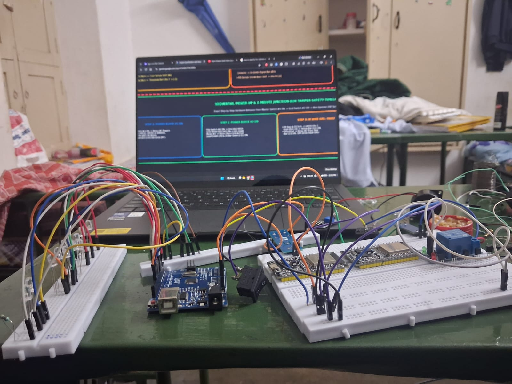
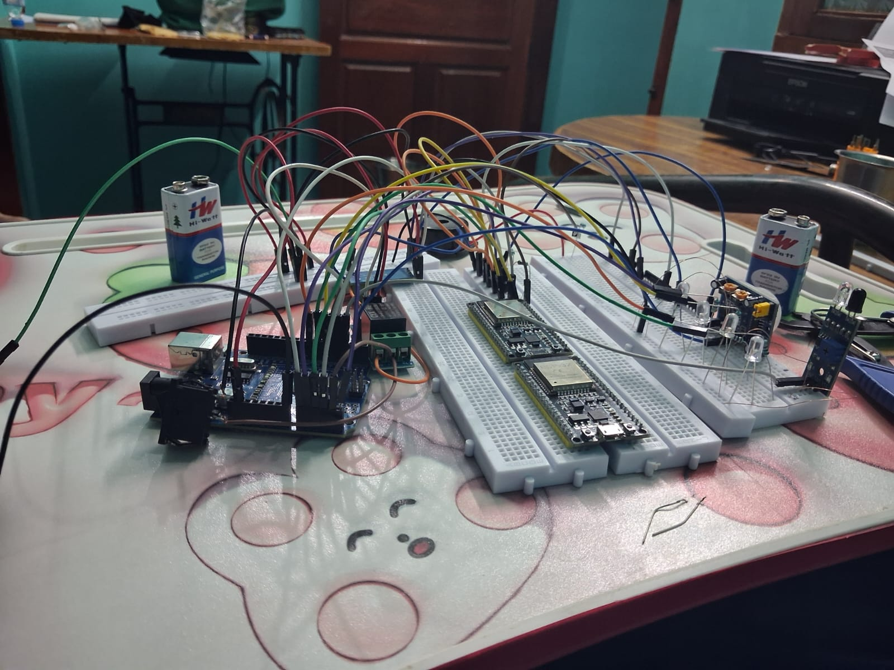

# Smart Grid Transmission-Line Fault & Distance Locator

A low-voltage smart-grid teaching prototype that detects an open line section, identifies which of three zones is affected, estimates fault distance, and demonstrates breaker operation through a local web dashboard.

> **Safety:** This is a tabletop 5 V educational simulation, not a utility-grid protection device. Never connect it to mains voltage, live utility wiring, or real transmission equipment.

## At a glance

- **Controller:** one ESP32 DevKit V1 (ESP32-WROOM-32)
- **Line model:** three 1 kΩ sections and a 1 kΩ end-of-line resistor, representing a 3 km corridor
- **Fault demonstration:** three removable jumper links simulate conductor breaks
- **Detection:** four ADC1 inputs read the ACS712 current sensor and three zone taps
- **Response:** a relay output, LEDs, and buzzer show the grid and fault state
- **Interface:** the ESP32 hosts a local Wi-Fi access point and browser dashboard; internet is not required
- **Optional alert:** a SIM800L/SIM900A modem can send SMS alerts

## Project photos

These photos document the breadboard prototype and dashboard during development. They are illustrative, not pin-by-pin wiring diagrams. The final architecture described here uses one ESP32; the photos may show earlier or additional prototype boards.



*Prototype setup with the browser dashboard running beside the breadboard circuit.*



*Prototype view of the controller boards, line sections, wiring, and indicators.*

## How it works

The project represents a transmission corridor as three equal-distance sections. A 5 V supply passes through a relay and current sensor, then through the line sections and an end-of-line load. Each section has a tap connected to an ESP32 analog input. Pulling out a section's jumper simulates a snapped conductor: the tap at that point and all downstream taps fall toward 0 V. Firmware compares the readings with a threshold, latches the first detected fault, opens the breaker relay, and displays the zone and estimated distance.

```text
5 V supply -> relay -> ACS712 -> Zone 1 -> Zone 2 -> Zone 3 -> 1 kΩ end load -> GND
                                  |             |             |
                               Pole 1        Pole 2        Pole 3
                              GPIO 35       GPIO 32       GPIO 33
                               1.00 km       2.00 km       3.00 km
```

The model scale is **15 cm = 1 km**, so its 45 cm corridor represents 3 km.

### Expected line-tap readings

With four equal 1 kΩ resistors and a 5 V input, the healthy tap voltages are approximately:

| Tap | Model distance | Healthy voltage | Effect of a break |
|---|---:|---:|---|
| Pole 1 | 1 km | 3.00 V | Pole 1 and downstream taps fall toward 0 V |
| Pole 2 | 2 km | 2.00 V | Pole 2 and Pole 3 taps fall toward 0 V |
| Pole 3 | 3 km | 1.00 V | Pole 3 tap falls toward 0 V |

Firmware uses **0.35 V** as the low-voltage fault threshold. Actual readings depend on the supply, resistor tolerances, wiring, and ADC calibration.

## Hardware and pin map

Keep all analog measurements on **ADC1**. ESP32 ADC2 is unavailable while Wi-Fi is active, so do not move these analog signals to ADC2 pins.

| ESP32 pin | Direction / bus | Connection | Purpose |
|---|---|---|---|
| GPIO 34 | ADC1 input | ACS712 OUT | Line-current measurement; nominal zero-current output is about 2.50 V |
| GPIO 35 | ADC1 input | Pole 1 tap, row 15 | 1 km zone measurement |
| GPIO 32 | ADC1 input | Pole 2 tap, row 30 | 2 km zone measurement |
| GPIO 33 | ADC1 input | Pole 3 tap, row 45 | 3 km zone measurement |
| GPIO 19 | Digital output | Relay module IN | HIGH energizes/closes; LOW opens/trips |
| GPIO 18 | Digital output | Piezo buzzer (+) | Pulses every 500 ms during an active fault |
| GPIO 25 | Digital output | Two green signal LEDs | Solid on when healthy |
| GPIO 26 | Digital output | Yellow signal LED | Solid for Pole 2; flashes for Pole 3 |
| GPIO 27 | Digital output | Red signal LED | Pole 1, manual trip, or overload |
| GPIO 5 | Digital output | Grid status white LED | On when modeled grid power is energized |
| GPIO 2 | Onboard LED output | ESP32 onboard LED | 500 ms system heartbeat |
| GPIO 4 | Digital output | System green LED | On when the line is healthy |
| GPIO 21 | Digital output | Emergency red LED | Flashes during a tripped fault |
| GPIO 22 | Digital output | Consumer-load green LED | On when power reaches the modeled load |
| GPIO 13 | Digital output | Consumer-load red LED | On during consumer blackout / trip |
| GPIO 16 / 17 | UART1 RX / TX | SIM800L/SIM900A TXD / RXD | Optional SMS alerts at 9600 baud; GPIO 16 receives modem TXD, GPIO 17 sends to modem RXD |

Use the specified LED series resistors (typically 220–330 Ω). Confirm that the relay module recognizes a 3.3 V ESP32 HIGH and check polarity and common ground before powering the circuit.

### Line ladder connections

1. Route the 5 V feed through relay COM/NO and the ACS712 current path to row 5.
2. Install R1 (1 kΩ) from row 5 to row 10, then the removable Pole 1 jumper from row 10 to row 15.
3. Install R2 (1 kΩ) from row 15 to row 22, then the Pole 2 jumper from row 22 to row 30.
4. Install R3 (1 kΩ) from row 30 to row 37, then the Pole 3 jumper from row 37 to row 45.
5. Install R4 (1 kΩ) from row 45 to the common ground rail.
6. Connect the Pole 1, Pole 2, and Pole 3 taps to GPIO 35, GPIO 32, and GPIO 33 respectively.

The jumpers are **demonstration links**, not protective fuses. Removing one simulates a conductor break; it does not provide real overcurrent protection.

## Fault handling and indicators

At startup, firmware calibrates the ACS712 zero offset using a 32-sample average. It waits 400 ms after a power/reset transition before evaluating faults, allowing the relay to settle. A trip is latched so opening the relay does not erase the original fault location when downstream voltages disappear.

| State | Detection / action | Signal LEDs (GPIO 25 / 26 / 27) |
|---|---|---|
| Healthy | Normal readings; no trip | Green solid / Yellow off / Red off |
| Pole 1 fault | Fault at 1 km, manual trip, or overload | Green off / Yellow off / Red solid |
| Pole 2 fault | Fault at 2 km | Green off / Yellow solid / Red off |
| Pole 3 fault | Fault at 3 km | Green off / Yellow flashing at 500 ms / Red off |
| Powered off | Dashboard turns modeled grid power off | All three off |

The specified overcurrent threshold is **35 mA**. A trip preserves the fault code, distance, and indicator state until reset.

## Local dashboard

The ESP32 creates its own Wi-Fi access point and serves the dashboard locally:

- **Network:** `SmartGrid-SCADA`
- **Password:** `12345678` *(default lab credential; change it before sharing the device beyond a controlled demonstration)*
- **Dashboard:** `http://192.168.4.1/`

The page polls `/data` every 500 ms. Available endpoints:

| Request | Action |
|---|---|
| `GET /` | Serve the dashboard page |
| `GET /data` | Return health, power, trip, zone, distance, current, tap voltages, signal state, and SMS status |
| `GET /power?state=0` or `1` | Turn modeled grid power off or on |
| `GET /trip` | Latch a manual trip (Pole 1 indication) |
| `GET /reset` | Clear the trip and restore healthy state after the settling delay |
| `GET /sim?mode=0..4` | Select real ADC readings, Pole 1, Pole 2, Pole 3, or overcurrent simulation |

## Getting started

1. Assemble and check the low-voltage ladder, grounds, and LED resistors against the pin map.
2. Upload the firmware to an ESP32 DevKit V1 using an ESP32 Arduino core supported by the project. Preserve the ADC1 assignments and `analogSetAttenuation(ADC_11db)` configuration.
3. Power the board from a suitable USB supply, then connect a phone or laptop to the ESP32 access point.
4. Open `http://192.168.4.1/` and confirm the healthy state and expected tap voltages.
5. Use the dashboard simulator to demonstrate each fault. To demonstrate a physical open-line event, remove one jumper at a time and observe the reported zone, distance, breaker, and indicators.
6. Reset from the dashboard before the next demonstration.

For Android OTG / ArduinoDroid uploads, the master specification recommends **115200 baud**. If upload synchronization fails, hold the ESP32 BOOT button while starting the upload.

## Engineering and safety notes

- This is a **5 V tabletop simulation only**. Never connect it to mains voltage, live utility wiring, or real protection equipment.
- The ACS712 is normally powered from 5 V and its analog output is centered near 2.5 V. Before a direct GPIO 34 connection, verify under every expected current and fault condition that its output stays within the ESP32 ADC's permitted range (never above 3.3 V). Add suitable signal conditioning or use a compatible sensor if it does not.
- Use only a relay module whose input is compatible with 3.3 V logic. In this demo, the relay switches only the low-voltage model.
- The default Wi-Fi password is shown for reproducibility, not security. Change it before deployment or public demonstrations.
- Trip thresholds and simulated distances are teaching/demo parameters, not certified protection settings or real-world distance measurements.

## Firmware compatibility reminders

The supplied master specification records these constraints for future changes:

- Keep the single-ESP32 architecture and ADC1 pin mapping above.
- Preserve the 400 ms settling window and latched-breaker behavior.
- For Arduino IDE / ArduinoDroid compatibility, use two-argument route bindings such as `server.on("/path", handler)` and serve the HTML string with `server.send(200, "text/html", INDEX_HTML)`, as specified.
- Keep the dashboard and device endpoints in sync if the JSON response or controls change.

## Source of truth

This README is a plain-language introduction based on the supplied **Smart Grid Transmission Line Fault & Distance Locator — Master Technical Specification**. For exact implementation and firmware behavior, treat that specification and the source code as authoritative.
